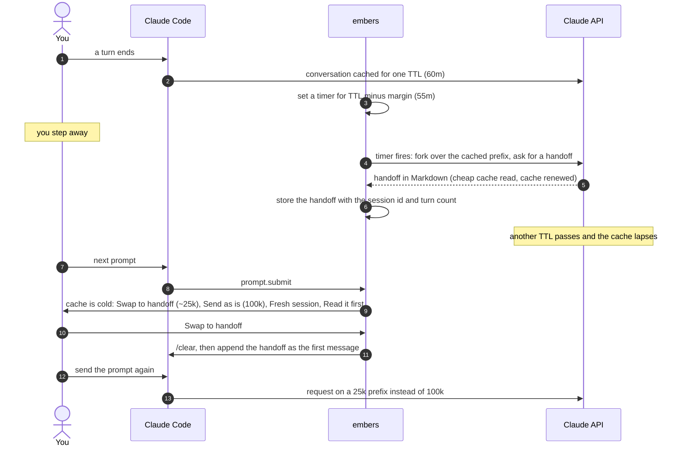
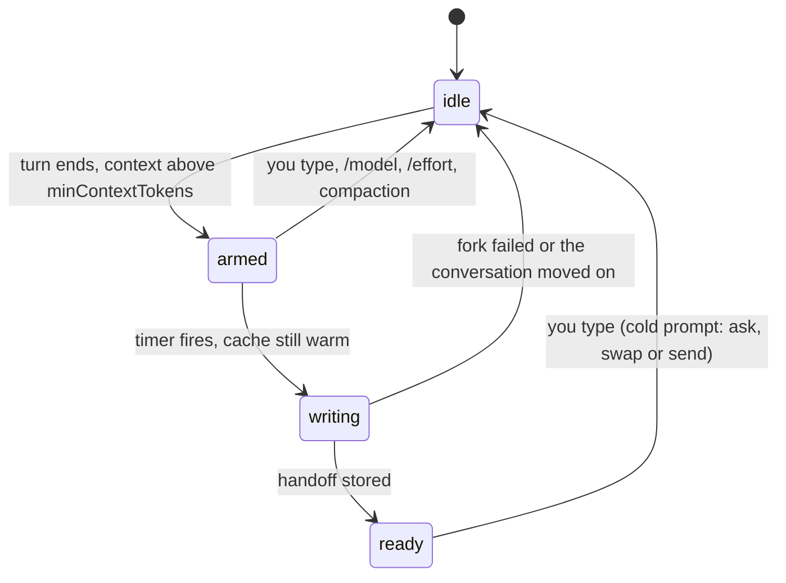
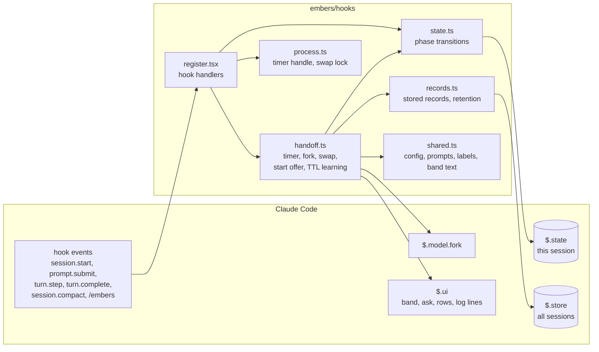

# embers

Claude's prompt cache lapses after a quiet hour (five minutes on some plans), and the next message after that pays to write your whole conversation to the cache again. embers writes a short handoff just before the cache lapses, while reading the conversation is still cheap. When you come back cold, you can continue from the handoff instead of rewriting everything.

## Why

On a 100k-token conversation, in input-token equivalents (a cache read costs 0.1, a cache write 1.25, output 5):

| You come back after the cache lapsed and... | Cost now | Next prompts |
|---|---|---|
| send as usual | ~125k: the whole conversation is written to the cache again | 100k prefix |
| swap to the embers handoff | ~15k for the handoff, written earlier while the cache was warm, plus ~31k to write a 25k prefix | 25k prefix |
| never come back | ~15k for one handoff | |

embers spends a little before you leave so that coming back costs less. It writes one handoff per idle period and nothing for small conversations.

## How it works



A fork rides the main conversation's cached prefix, so writing the handoff reads the conversation from cache instead of paying to write it. The fork is only made while the cache is still warm; a timer that wakes too late (a laptop that slept) skips it.

What embers tracks for the current session:



How the code is laid out:



- `$.state` holds the phase above, the last cache touch, and what embers learned about the TTL. It survives a reload.
- `$.store` holds handoffs (`handoff:<folder>:<session>`), handoffs already offered at start (`offered:<session>:<time>`), learned TTLs per model (`ttl:<model>`) and the monthly tally (`stats:<yyyy-mm>`). Handoffs older than 14 days are dropped.
- The TTL starts at `ttlMinutes`. If the first reply after an idle shorter than that comes back cold twice, embers stores the shorter TTL for that model for a day.

## Install

From the marketplace, for every session:

```
/plugin marketplace add ayagmar/claude-mods
/plugin install embers@ayagmar
```

Or from a clone, for one session:

```
git clone https://github.com/ayagmar/embers ~/projects/embers
claude --plugin-dir ~/projects/embers/embers
```

To load a clone in every session, set `CLAUDE_CODE_PLUGIN_DIRS` to `~/projects/embers/embers` in your shell or in the `env` block of `~/.claude/settings.json`.

## What you see

A line above the prompt, once the context is big enough:

```
embers  warm  handoff at 12:55
embers  writing handoff…
embers  handoff ready  12:55, 118k tokens, warm until 13:55
```

If you send a prompt after the cache has gone cold, embers asks what to do and shows what each choice costs:

- **Swap to handoff**: clear the session and continue from the handoff. Offered only when a handoff matches this conversation. Send your prompt again from the box.
- **Send as is**: send the prompt and rewrite the cache.
- **Fresh session**: clear the session with no handoff. Send your prompt again from the box.
- **Read it first**: show the handoff and change nothing. Send your prompt again to choose.

Each label carries the tokens the next request writes, such as `Send as is (100k)`. Pressing Esc, or typing your own answer, sends nothing and leaves your prompt in the box.

When a new session starts in a folder where an earlier one left a handoff on the same branch, embers offers to load it. Choose **Load it** or **Skip**. The model is told it comes from an earlier session and that files may have changed. The earlier session keeps its handoff, in case it is still open.

After a swap or a load, the handoff is drawn in the transcript as a block you can read, with a line naming the old conversation: `claude --resume <id>` returns to it. If a swap fails partway, a line says what happened.

Each handoff adds a line with its cost, such as `embers: Handoff written; read 26k from cache, wrote 7.6k, 937 out`.

## Commands

| Command | What it does |
|---|---|
| `/embers` | Writes a handoff now, and asks first if the cache is cold. |
| `/embers show` | Draws this session's handoff, or the one it swapped to, for you to read. The model is not sent it. |
| `/embers status` | Shows on or off, the cache, the phase, the last fork, the TTL, this folder's handoffs, and this month's tally: what handoffs cost and what swaps saved. |
| `/embers off` | Turns embers off until you run `/embers on` or quit. |
| `/embers on` | Turns it back on; the next turn to end arms it. |

## Options

Set these in the plugin's config menu.

| Option | Default | Meaning |
|---|---|---|
| `ttlMinutes` | 60 | How long the cache is assumed to last. A TTL reported by Claude Code or observed by embers overrides it. |
| `marginMinutes` | 5 | How long before the TTL the handoff is written. Cut for short TTLs. |
| `minContextTokens` | 40000 | Below this context size, embers does nothing. |
| `minSavingTokens` | 20000 | A swap must shrink the context by at least this much. |
| `coldMode` | `ask` | On a cold prompt: `ask`, `swap` without asking when a handoff matches, or `send` without asking. |
| `offerOnStart` | true | Offer an earlier handoff when a session starts. |
| `showBand` | true | Draw the line above the prompt. |
| `handoffInstructions` | empty | Added to the handoff prompt as its last sentence. |

## Cost

A handoff reads the cached conversation and, in the runs measured, writes little to the cache: 7.6k tokens after a conversation's first turn, and none after a turn of eight file reads that added 46k tokens. A session you abandon costs one handoff.

The design is in `docs/DESIGN.md`.

## Developing

```
npm ci && npm run check
```

That runs Biome, `tsc`, the plugin tests and `claude plugin validate`. The type-check needs the plugin API types, which Claude Code writes under `embers/.claude-plugin/types/` the first time the mod loads with the `plugin-authoring` skill active; they are gitignored. `docs/probes/` holds a small plugin whose test shows why the swap clears the session instead of compacting it.
