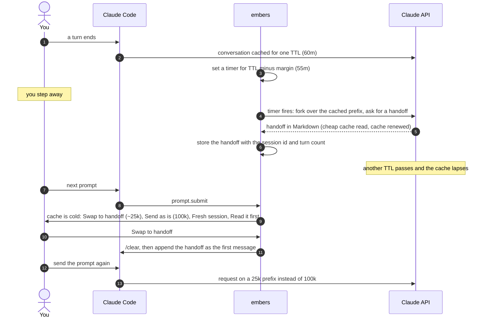
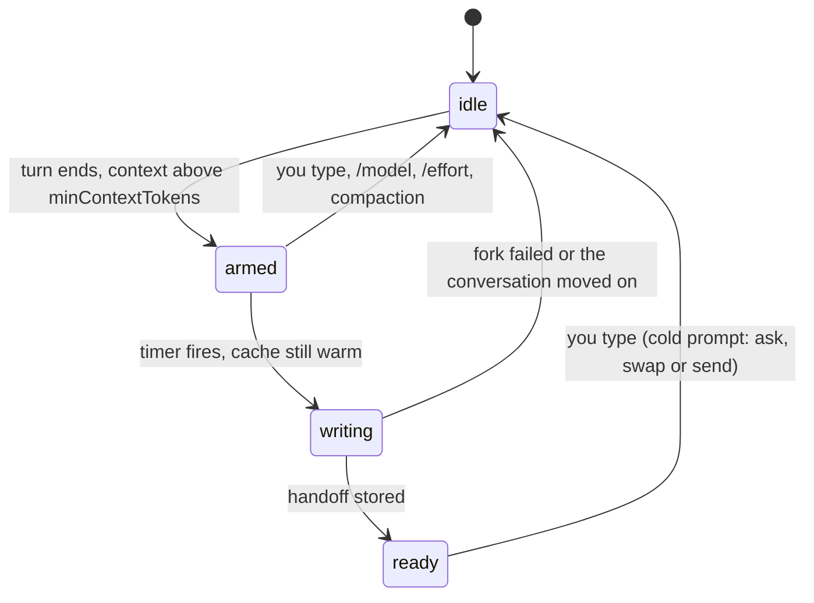
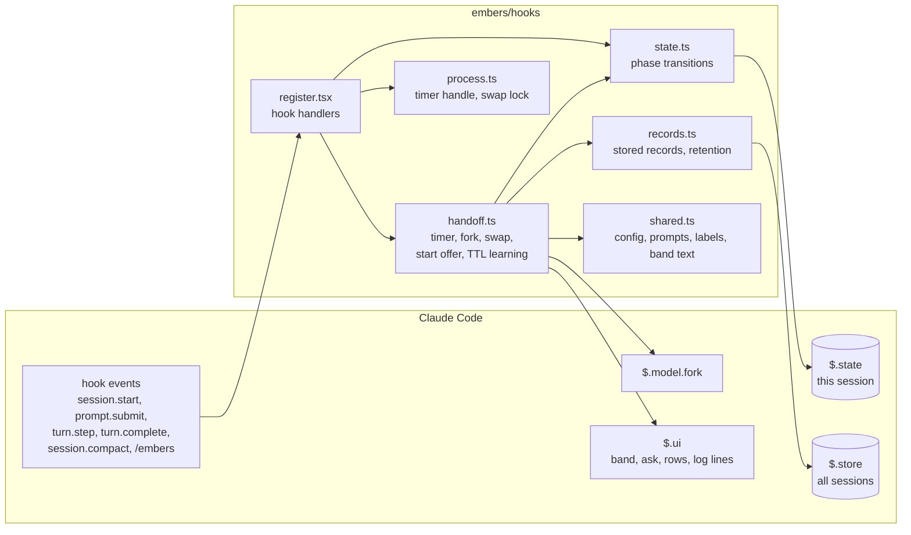

# embers: design

Revision 2. Line references `d.ts:<n>` point into the plugin API types of the Claude Code build this was designed against (2.1.319). Claude Code writes them locally: load the `plugin-authoring` skill in a session, and they appear under `embers/.claude-plugin/types/claude-code/index.d.ts` once the mod has loaded (gitignored).

## Problem

Claude Code sends the whole conversation on every request. The API serves the unchanged prefix from a prompt cache at a tenth of the input price, but the entry lapses after an idle period (the TTL: one hour on this account, five minutes under overage or on other plans). The first request after a lapse writes the whole prefix again at 1.25 times the input price. On a 100k-token session that is the most expensive request of the day, and it buys nothing: the next request is warm again.

Two things make it worse:

- You cannot tell at send time that the cache is cold, and once it is cold, every way of shrinking the context (a summary, a handoff, compaction) also reads the cold prefix.
- Writing a handoff for every idle session is a waste when you never come back to it.

## What embers does

1. **Warm handoff.** When a main-loop turn ends on a session whose context is above a size threshold, embers arms one timer for TTL minus a margin. If the session is still idle when it fires, embers asks the model for a handoff with `$.model.fork`. A fork rides the main thread's cached prefix, so it costs the handoff's output tokens plus a cache write of its uncached tail (see "Rules that keep it cheap"). A cache read also renews the entry, so the fork keeps the prefix warm for one more TTL. The handoff is stored in `$.store`, bound to the session id and turn count it was written from.

2. **Cold prompt.** On a person's `prompt.submit` on the main loop, embers compares the time since the last cache touch (the last main-loop turn end, or a later fork that read the cache) with the TTL.
   - Under the TTL: the prompt passes through. Nothing drawn, nothing logged.
   - Over the TTL: embers asks, inside the hook with `$.ui.ask`. The choices:
     - **swap** (first, offered only when a handoff is on file and matches the session id and turn count): the hook drops the prompt; from `$.clock.after(0, …)` embers runs `/clear`, appends the handoff and the last reply as the new conversation's first row with `$.session.append`, and deletes the handoff. The person sends the prompt again from the box, and it enters on the short prefix. No model call.
     - **send**: `next(e)` with the prompt intact; it enters cold and the cache rewarms on that request.
     - **fresh**: the hook drops the prompt and runs `/clear` from `$.clock.after(0, …)`; the person sends it again.
   - Swap and fresh drop the prompt because the host refuses both a compaction and a command under the turn a `prompt.submit` hook holds (`d.ts:3236`). A compaction from the timer instead runs past the calling plugin's own `session.compact` hook, so core would summarize the cold prefix with a model call. `docs/probes/compact-in-prompt-submit` is a kit test that shows both. The engine puts a dropped prompt back in the box by itself; attachments must be pasted again, and the drop reason says so. Until the swap or fresh start ends, a prompt sent again is dropped with `embers: still swapping; send again when it says done`.
   - The swap's `/clear` gives a new session id. A one-line log names `claude --resume <old id>`, which returns to the old conversation, and the handoff is drawn as a Markdown row placed with `$.ui.place`, which the model does not read. The host heads each `$.ui.log` line with the plugin's name, so embers' own lines carry no `embers:` prefix; a test fails on one that does. A `$.ui.log` line is one line: the terminal replaces newlines and cuts it at 2000 characters, so the handoff never goes through it. A swap that fails says so in a log line; the cache is forgotten only when the `/clear` went through.
   - Without a matching handoff the ask offers only send and fresh. Writing a handoff at that point would itself reread the whole cold prefix P at the cache-write price, the same 1.25 × P that sending pays, and the swap would then write the short prefix S at 1.25 × S on top. Sending leaves P warm, read at 0.1 × P per later request. For P = 100k and S = 25k the swap adds about 31k token-equivalents now to save 7.5k per later request: it pays back only after four or more.
   - **read** (last, offered with swap): the hook drops the prompt and places the handoff for the person to read. Nothing else changes, so the prompt sent again is asked about again.
   - Each label carries what the next request writes, since `$.ui.ask` takes no descriptions: `Swap to handoff (~25k)`, `Send as is (100k)`, `Fresh session (~20k)`, `Read it first`. The question: `The prompt cache is cold (65m idle). Sending rewrites 100k tokens; swapping to the 12:55 handoff or a fresh session clears it (paste attachments again). What now?` Answers are matched to choices by the labels built for that ask.
   - `coldMode` `swap` skips the ask when a matching handoff is on file. `send` never asks. Dismissing the ask, or typing under "Other", drops the prompt with nothing spent. Where the ask rejects and the session has no surface (`-p`), the prompt is sent.
   - The swap is skipped, and the prompt sent, when the saving is small: context tokens minus (system and tools tokens plus handoff tokens) below `minSavingTokens`. The system and tools figure comes from `$.session.usage({ breakdown: "summary" })`.

3. **Handoff on start.** When an interactive session starts with no turns yet (not under `-p`, not a resumed conversation) in a project where a previous session left a handoff older than the TTL on the same branch, embers offers it once per session (`startOffered`, which survives a reload). The check runs in `session.start`; the classic `SessionStart` hook is not used, since an organization plugin can bypass it. Loading appends it as a user message with `$.session.append`, under its own header: a handoff from an earlier session, its date and branch, and that files may have changed. Load and Skip both leave the handoff as it is, since its own session may still be open and swap to it or write a newer one, and mark it shown under a key of their own, `offered:<sessionId>:<writtenAt>`. It is not offered again, and retention removes it later. The offer shows the handoff's time and branch.

4. **TTL observation.** embers reads the TTL from the engine where it says it (`cache_ttl` on the classic model-switch hooks, `d.ts:8239`) and otherwise observes it from the main loop's first response after an idle: a near-zero `cache_read_input_tokens` after an idle shorter than the configured TTL, on the same model, means the real TTL is shorter. A reload, an MCP reconnect or a changed system prompt also makes one read cold, so the first observation is only held in `$.state.lapse`; a second on the same model, in a later idle period, stores the TTL per model, where it overrides the configured one. A warm read after an idle longer than a held or stored TTL clears it. A stored observation expires after a day, as cold reads that were not a lapse can produce one; a TTL Claude Code reported (`source: 'reported'`) does not expire. Reads are skipped when the model changed since the last cache touch, or after `/effort`. Fork results are not used for this: a cold fork can also follow `/model` or a late timer.

## Diagrams

A fork rides the main conversation's cached prefix, so writing the handoff reads the conversation from cache instead of paying to write it. The timer forks only while the cache should still be warm, and skips the fork if it wakes too late (a laptop that slept). `/embers` can write a handoff on a cold cache, after asking, since that rereads the whole conversation.

What embers tracks for the current session:

How the code is laid out:

- `$.state` holds the phase above, the last cache touch, and what embers learned about the TTL. It survives a reload.
- `$.store` holds handoffs (`handoff:<folder>:<session>`), handoffs already offered at start (`offered:<session>:<time>`), learned TTLs per model (`ttl:<model>`) and the monthly tally (`stats:<yyyy-mm>`). Handoffs older than 14 days are dropped.
- The TTL starts at `ttlMinutes`. If the first reply after an idle shorter than that comes back cold twice, embers stores the shorter TTL for that model for a day.

## Rules that keep it cheap

- One fork per idle period. The timer does not re-arm until the next main-loop turn ends. An abandoned session costs one handoff.
- Nothing happens below `minContextTokens`. The size is `(await $.session.usage()).context.tokens` read in the main-loop `turn.complete`; absent (right after a compaction) counts as below threshold. `e.usage` on `turn.complete` sums every response of the turn and is the wrong figure. A `turn.complete` with no `e.usage` (an API error, or an interrupt before any request counted) read nothing from the cache: the last touch stands and nothing is armed.
- The fork names no `effort`. On a model without per-message effort, a named effort rewrites the whole conversation into a new cache entry. The handoff prompt says there are no tools and asks for a direct answer without deliberation, in Markdown under fixed headings: Goal, Decisions, State, Open questions, Next step.
- What the fork writes to the cache was small in every run measured, at 1.25 times the input price, in an entry the main thread does not reuse: about 7.6k tokens after a conversation's first turn, 3 after a short second turn, and 0 after a turn of eight sequential file reads that took the context from 33.5k to 79k tokens (that fork read 79,076 from cache, 127 uncached input, 1,512 output). An earlier reading, that a fork rewrites all of the last turn's tool output, did not hold in that run.
- The fork is skipped when the effort level changed while idle, when a turn is running, when the session is not interactive, and when the wall clock says the cache has already lapsed (a laptop that slept through the deadline). A skipped fork writes nothing.
- `/embers` on a cold cache says so and asks before forking.
- Every fork and swap logs one line with what it cost, so the cost is visible: a fork in words, `read 26k from cache, wrote 7.6k, 937 out`, with `(cold)` when the read was cold; a swap as the tokens before and after.

## Scope filters

- Act on the main loop only: every hook returns `next(e)` first when `e.agentId !== undefined`.
- At `prompt.submit`, act only when `!e.command`, `!e.turnId`, `!e.isMeta`, and `e.origin` is absent or its kind is `composer` or `bridge`. Slash commands, queued prompts, task notifications, `/loop`, peers and plugins pass through untouched.
- The `session.compact` hook only watches: every compaction gets `next(e)`, and a main-loop one that stands resets the cache touch, since the next request writes a new prefix.

## State

`$.state` (session, JSON only; survives a hot reload, starts over under the new session id after a `/clear`):

- `phase`, a union tagged by `kind`, carrying what is valid in it:
  - `idle`, with a `cache` when one is known
  - `armed`, with a `cache` and the `deadline` the timer should fire at
  - `writing`, with a `cache` unless a manual `/embers` started with none known
  - `ready`, with a `cache` and the `handoffAt` of the handoff on file
- `cache`, inside the phase: `touchedAt` (epoch ms of the last main-loop turn end or warm fork), `model` (the model at that turn end; the timer and the TTL observation act only while it is unchanged; absent when the touch came from a handoff), `contextTokens` (from the last main-loop `turn.complete`, or absent), `warmUntil` (`touchedAt` plus the TTL in force)
- `isOff`: `/embers off`
- `startOffered`: whether the start offer was shown this session
- `lapse`: a held or stored TTL observation (see "TTL observation")
- `lastFork`: when the last fork that reached the API ended, and its usage, for `/embers status`

`hooks/state.ts` owns this value. Each change is a named pure function applied through `apply($, transition, input)`: `turnEnded`, `promptStarted`, `forkStarted`, `forkSkipped`, `forkFailed`, `forkWritten`, `cacheTouched`, `prefixReplaced` (a compaction, a model switch, `/effort`, or a swap or fresh start), `cleared`, and the small ones for the offer, the lapse and the off switch. A value stored under an older shape reads as the initial state.

`hooks/process.ts` holds what must outlive a `/clear` and may start over on a reload: the timer handle, whether a swap is running, `isOff`, the Markdown of each placed handoff row, and the handoff last swapped or loaded, for `/embers show`. A reload empties the placed rows, which then draw nothing. `/embers off` holds for the process through that variable and `$.state`: `isOff(run)` reads either. `/embers off` and `/embers on` write both, `session.start` copies the state to the variable after a reload, and every state write copies an off variable into the state, so off survives a reload that follows a `/clear`. A `/clear` starts `$.state` over and no `session.start` follows it. Whether the session is interactive is not kept: `turn.complete` reads `$.session.surfaces()`, empty under `-p`.

The effort level is not kept: no API reads it while idle. `/effort` disarms the timer and forgets the cache, as a compaction does; a fork still running then is reported as moved on.

`session.start` (which fires on reload too) first moves the cache's end and an armed `deadline` to the TTL in force, unless the cache was touched on another model, and drops a stored `lapse` that no longer matches it (an observed TTL expires after a day). It then re-arms from the `deadline` when the phase is `armed`, firing at once if it has passed. The timer is cancelled at main-loop `prompt.submit` and `turn.start`. When it fires, it re-reads `$.state` and the clock before forking.

`$.store` (across sessions), one key per record, no index:

- `handoff:<root>:<sessionId>`: `{ v: 1, root, branch, sessionId, turns, writtenAt, contextTokens, text, lastAssistant, offeredAt? }`. `offeredAt` was written by 0.1.0's start offer; it is still read, so a handoff 0.1.0 offered is not offered again, and never written. `lastAssistant` is the last assistant message's text, taken from `$.session.messages()` before the fork, because the fork's view ends at the last request and never sees the final reply. The swap appends it after the handoff.
- `offered:<sessionId>:<writtenAt>`: `{ v: 1, sessionId, writtenAt }`, the start offer showed that handoff. Writing it is best effort: a refused write costs a repeat offer, not the Load. A newer handoff of the same session has another `writtenAt` and is offered again. embers 0.1.0's retention deletes these keys, so with both versions running a handoff can be offered twice.
- `ttl:<model>`: `{ v: 1, observedMinutes, observedAt, source? }`.
- `stats:<yyyy-mm>` (local time): `{ v: 1, forks, forkCost, swaps, swapSaved, loads }`, in input-token equivalents at a cache read 0.1, a cache write 1.25 and output 5. A fork that reached the API adds its cost; a swap adds 1.25 × (context tokens − the new prefix). `$.store` has no update, so two sessions adding at once can lose one addition.

Retention: a handoff is deleted when swapped to, loaded, or overtaken by a later main-loop turn of its own session. While a root holds more than 10 handoffs, the oldest that are not the newest of their branch and are older than twice the TTL are dropped until it holds 10. A younger one may belong to a session still open in the same checkout, and an older one to a session resumed later. Handoffs and offer marks whose handoff was written more than 14 days ago are dropped. Both run on session start and after each handoff is written. Every read validates `v` and shape; a record that fails is treated as absent and deleted.

Session id, root and turns are captured before every await and bound to the record; `/clear` mid-fork must not store the old conversation under the new id. After the fork the phase is read through `update`: every `$.state.get` of one dispatch reads one moment (`d.ts:3558`), so a plain read after that wait can be stale.

Resume: `session.start`, when no cache is known, reads the session's own handoff and, when its turn count still matches, seeds a cache touched at `writtenAt` with the record's `contextTokens`. A matching handoff is the only case where a swap is possible. `context.tokens` is absent until the first response of a resumed process, so the cold path falls back to the seeded `contextTokens`. Classic hooks are not used for this: an organization plugin can bypass a mod's `classic.*` hooks.

## Configuration (`userConfig`)

| key | type | default | meaning |
|---|---|---|---|
| `ttlMinutes` | number | 60 | assumed cache lifetime; overridden by an engine-reported or observed TTL |
| `marginMinutes` | number | 5 | how long before the TTL the handoff is written; cut to a fifth of a short TTL, but not under a minute (1m for a 5m TTL: the fork runs at 4m) |
| `minContextTokens` | number | 40000 | below this, embers does nothing |
| `minSavingTokens` | number | 20000 | a swap must shrink the prefix by at least this |
| `coldMode` | `ask` / `swap` / `send` | `ask` | see "Cold prompt" |
| `offerOnStart` | boolean | true | offer the last handoff of this root and branch on session start |
| `showBand` | boolean | true | draw the band above the prompt |
| `handoffInstructions` | string | empty | added to the handoff prompt as its last sentence when set |

A `userConfig` change reloads the mod; the state above survives it.

## UI

- **Band** above the prompt, drawn only when the context is above threshold and `showBand` is on, redrawn on state changes only (absolute times, no countdown):
  - armed: `embers  warm  handoff at 12:55`
  - writing: `embers  writing handoff…`
  - ready: `embers  handoff ready  12:55, 118k tokens, warm until 13:55`
  - ttl stored: `embers  cache lapsed after 5m  margin now 1m`
- **Ask** (`$.ui.ask`) on a cold prompt, with the options above and one line of cost: the context size, what sending cold costs, what the swap costs.
- **Log line** once per handoff, swap, load or skipped fork, with the token figures; a timer fires when nobody is looking, and a toast is gone in four seconds.
- **Placed row** after a swap, a load or `/embers show`: the handoff as Markdown, for the person only.
- **Commands**: `/embers` writes a handoff now (asks first if the cache is cold); `/embers show` places this session's handoff, or the one swapped or loaded in this process; `/embers status` says whether embers is on, the cache (warm until a time, cold since a time, or unknown), the phase in words, the last fork's figures and time, this root's handoffs, the TTL in force, and this month's tally; `/embers off` disables it for this process and `/embers on` undoes that.
- **Status line**: nothing.

## Not in scope

Keeping the cache alive beyond the one touch the handoff fork makes. Subagent sessions. Non-interactive runs beyond doing nothing in them.
